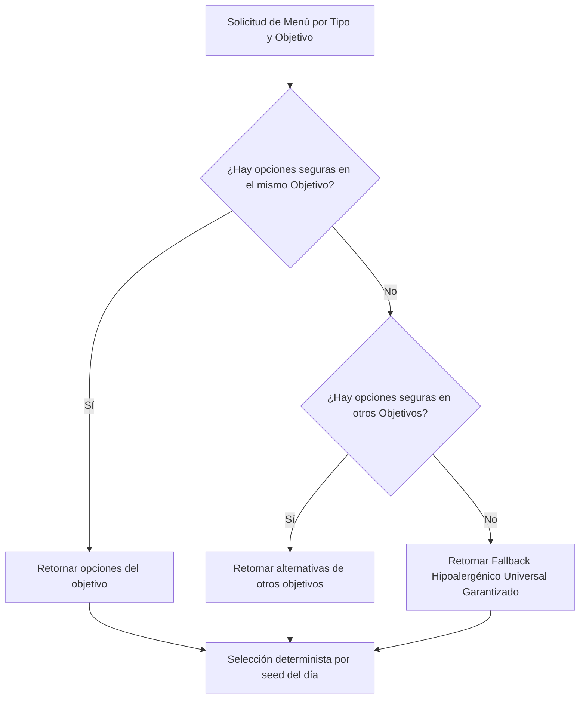

# Especificación de Reglas de Filtrado y Casos de Prueba (US37 – US39)
**VigoriaFit — Sistema de Salud, Nutrición y Entrenamiento Adaptativo**  
**Sprint 2 — Paso 8 (#US37, #US38, #US39)**

---

## 1. Introducción y Propósito

Este documento establece formalmente las **reglas de filtrado, compatibilidad y seguridad médica** que rigen en VigoriaFit para los tres módulos de prescripción de hábitos:
1. **US37: Módulo de Nutrición y Planificación de Menús**
2. **US38: Módulo de Recomendaciones y Precauciones de Suplementos**
3. **US39: Módulo de Entrenamiento, Rutinas y Adaptación por Lesiones**

Estas reglas garantizan que ningún usuario reciba recomendaciones que pongan en riesgo su salud (alergias alimentarias, hipertensión, nefropatías, diabetes o lesiones articulares), protegiendo la experiencia del usuario y sirviendo de contrato para los módulos desarrollados en sprints posteriores.

---

## 2. US37: Reglas de Filtrado Nutricional (Alimentos y Menús)

### 2.1. Criterios de Aceptación
- **CA-37.1 (Alergias)**: Si el usuario declara alergias (`Allergy`), ninguna comida que contenga dicho alérgeno puede ser sugerida.
- **CA-37.2 (Condiciones Médicas)**: Si el usuario presenta patologías crónicas, las comidas con banderas dietéticas de riesgo (`dietFlags`) deben ser descartadas automáticamente.
- **CA-37.3 (Priorización por Objetivo)**: Se priorizan comidas alineadas con la meta calórica y de macronutrientes del usuario (`Goal`).
- **CA-37.4 (Garantía contra Reaparición - Bug #98)**: Si no existen alternativas exactas para un objetivo, el sistema busca en otros objetivos de la misma categoría. Si todas las opciones del catálogo son descartadas por restricciones múltiples, el sistema **NUNCA reintroduce comidas descartadas**; en su lugar, entrega una alternativa hipoalergénica universal segura (`safeFallbackFor`).
- **CA-37.5 (Exclusiones Individuales)**: Soporte para descartar comidas específicas por nombre (`excludedNames`).

### 2.2. Matriz de Filtrado Nutricional

| Condición / Alergia | Tipo | Flag / Alérgeno Evaluado | Alimentos Descartados en Catálogo | Alternativa Segura Sugerida |
|---|---|---|---|---|
| **Lactosa** | `Allergy.lactosa` | `Allergy.lactosa` | Yogurt natural, Batido de plátano, Carne con puré, Yogurt griego | Bowl de chía con frutas, Tostadas con tomate |
| **Gluten** | `Allergy.gluten` | `Allergy.gluten` | Huevos con pan integral, Tostadas integrales, Sopa con pan | Pollo a la plancha con arroz, Salmón con quinoa |
| **Frutos Secos** | `Allergy.frutosSecos` | `Allergy.frutosSecos` | Puñado de almendras, Manzana con mantequilla de maní | Zanahoria y apio con hummus, Mix con semillas de girasol |
| **Huevo** | `Allergy.huevo` | `Allergy.huevo` | Huevos revueltos, Ensalada con atún y huevo, Tortilla de verduras | Pechuga con verduras salteadas, Bowl de chía |
| **Mariscos** | `Allergy.mariscos` | `Allergy.mariscos` | Ensalada con atún y huevo | Pollo a la plancha, Salteado de pavo |
| **Diabetes / Prediabetes** | `HealthCondition` | `dietFlags: ['highSugar']` | Batido de plátano con leche, Yogurt griego con miel | Papas doradas con palta, Huevos revueltos |
| **Enfermedad Renal** | `HealthCondition` | `dietFlags: ['highPotassium']` | Porotos con riendas | Pollo con arroz blanco, Salmón al horno |
| **Hipertensión** | `HealthCondition` | `dietFlags: ['highSodium']` | Embutidos, caldos concentrados | Comidas con hierbas naturales y bajo sodio |
| **Gastritis / Reflujo** | `HealthCondition` | `dietFlags: ['irritant']` | Comidas picantes o ácidas | Verduras al vapor, carnes magras |

### 2.3. Cascada de Resolución de Menús

---

## 3. US38: Reglas de Filtrado y Precauciones de Suplementos

### 3.1. Criterios de Aceptación
- **CA-38.1 (Priorización por Meta)**: Suplementos con evidencia para el objetivo del usuario (`Goal`) se muestran en primera posición.
- **CA-38.2 (Detección de Contraindicaciones)**: Si el perfil del usuario tiene una condición presente en `cautionFor`, el suplemento se marca con advertencia médica (`hasCaution == true`) y se presenta la nota explicativa (`cautionNote`).
- **CA-38.3 (Principio de Transparencia)**: En lugar de ocultar la información educativa, el sistema alerta proactivamente al usuario con badge visual y texto de precaución médica.

### 3.2. Matriz de Suplementación y Salud

| Suplemento | Objetivo Primario (`Goal`) | Condición de Precaución (`cautionFor`) | Fundamento Clínico y Nota Mostrada |
|---|---|---|---|
| **Creatina monohidrato** | Ganar Músculo, Mantener | `HealthCondition.enfermedadRenal` | Filtración renal: en nefropatías se debe controlar la sobrecarga nitrogenada. |
| **Proteína de suero (Whey)** | Ganar Músculo, Perder Grasa | `HealthCondition.enfermedadRenal` | Metabolismo proteico: dietas hiperproteicas requieren ajuste médico estricto en daño renal. |
| **Cafeína / Pre-entreno** | Perder Grasa, Ganar Músculo | `HealthCondition.hipertension` | Efecto hemodinámico: taquicardia y alza tensional aguda transitoria. |
| **Magnesio** | Salud, Ganar Músculo | `HealthCondition.enfermedadRenal` | Excreción comprometida: riesgo de hipermagnesemia en insuficiencia renal. |
| **Omega-3** | Salud, Mantener, Perder Grasa | *Sin contraindicación crítica general* | Seguro en dosis habituales (1-2 g/día). |
| **Vitamina D** | Salud, Mantener | *Sin contraindicación crítica general* | Regulación del calcio y respuesta inmune. |

---

## 4. US39: Reglas de Filtrado de Entrenamiento y Lesiones

### 4.1. Criterios de Aceptación
- **CA-39.1 (Entorno y Acceso a Equipo)**:
  - Si `profile.hasGym == false`: Solo se muestran rutinas caseras sin equipo (`needsGym == false`).
  - Si `profile.hasGym == true`: Se muestran tanto rutinas de gimnasio como de casa, priorizando las de gimnasio.
- **CA-39.2 (Alineación con Objetivo)**: La rutina del día (`todayFor`) y el orden del catálogo priorizan el objetivo del usuario (`p.goal`).
- **CA-39.3 (Protección Articular y Lesiones)**:
  - Si el usuario declara **Lesión de rodilla** (`HealthCondition.lesionRodilla`), los ejercicios con impacto o flexión profunda quedan marcados con advertencia de adaptación (`hasExerciseCaution == true`).
  - Si el usuario declara **Lesión de espalda** (`HealthCondition.lesionEspalda`), los ejercicios de carga axial o flexión espinal quedan marcados con advertencia.

### 4.2. Matriz de Restricciones en Ejercicios

| Ejercicio | Rutina | Condición Evitada (`avoidConditions`) | Justificación Biomecánica y Adaptación |
|---|---|---|---|
| **Burpees** | HIIT quema grasa | `lesionRodilla` | Impacto en aterrizaje y estrés patelofemoral. Adaptar a step-back sin salto. |
| **Jumping jacks** | HIIT quema grasa | `lesionRodilla` | Fuerza de reacción contra el suelo repetitiva. Adaptar a step-jacks. |
| **Sentadilla con salto** | HIIT quema grasa | `lesionRodilla` | Desaceleración violenta y sobrecarga articular. Adaptar a sentadilla isométrica. |
| **Rodillas al pecho** | HIIT quema grasa | `lesionRodilla` | Impacto balístico en rodilla y cadera. Adaptar a marcha en el lugar. |
| **Mountain climbers** | Full body en casa | `lesionRodilla` | Cizallamiento continuo en tendón rotuliano. Adaptar a plancha isométrica. |
| **Remo con barra** | Tren superior (gym) | `lesionEspalda` | Momento de fuerza lumbar sin soporte torácico. Adaptar a remo en máquina con apoyo de pecho. |
| **Peso muerto rumano** | Tren inferior (gym) | `lesionEspalda` | Carga de cizalla lumbosacra elevada. Adaptar a curl femoral acostado en máquina. |

---

## 5. Matriz de Casos de Prueba Automatizados

Los criterios anteriores han sido validados a través de suites de pruebas unitarias automatizadas:

| Historia | Suite de Pruebas | Casos Verificados | Resultado |
|---|---|---|---|
| **US37** | [`test/food_filter_safety_test.dart`](file:///d:/vigoriafit/test/food_filter_safety_test.dart) | 1. Exclusión total de alérgenos. 2. Búsqueda en otros objetivos. 3. Descarte total sin reaparición (Bug #98). 4. Exclusiones individuales (`excludedNames`). 5. Banderas clínicas (`highSugar`, `highPotassium`). 6. Fallback universal hipoalergénico. | ✅ 6/6 aprobados |
| **US38 & US39** | [`test/filtering_rules_us37_us39_test.dart`](file:///d:/vigoriafit/test/filtering_rules_us37_us39_test.dart) | 1. Priorización de suplementos por objetivo. 2. Detección de precauciones renales e hipertensión. 3. Filtrado de rutinas por `hasGym`. 4. Detección de lesiones en ejercicios (rodilla/espalda). 5. Conteo y extracción de condiciones conflictivas. 6. Consistencia entre perfil del usuario y recomendaciones. | ✅ 6/6 aprobados |
